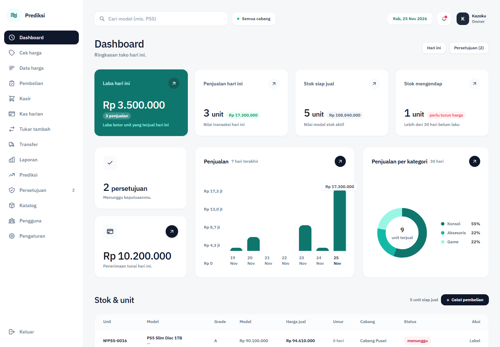
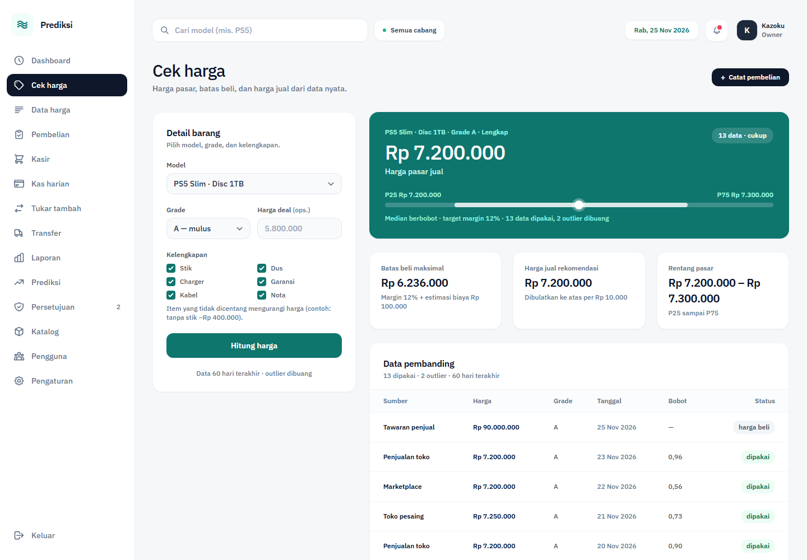
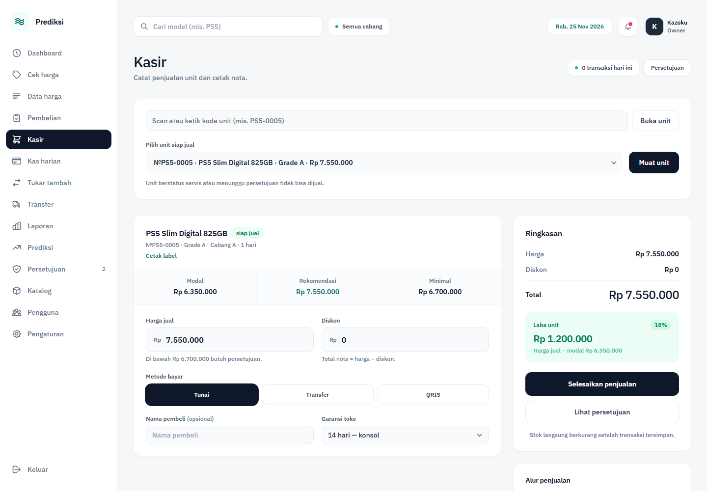
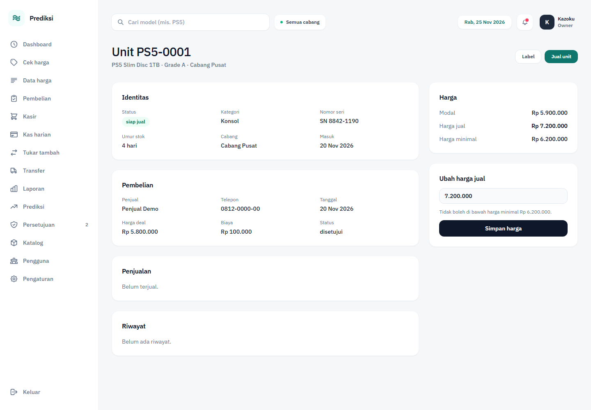
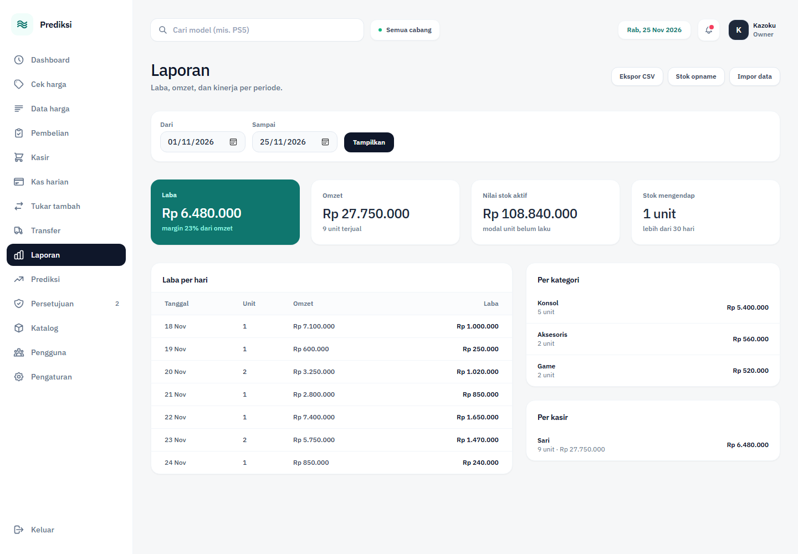
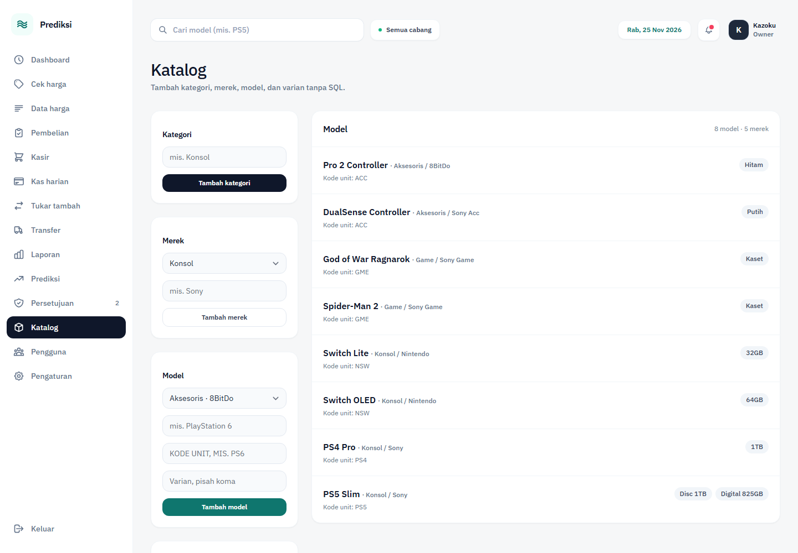

# Prediksi — sistem harga & stok barang second

Studi kasus portofolio. Aplikasi internal untuk toko gadget second: menilai harga pasar, menetapkan batas beli, dan menjaga laba per unit dari pembelian sampai kas harian.

- **Peran:** solo developer, end-to-end
- **Stack:** Go, MySQL 8, HTML + Tailwind, HTMX
- **Konteks:** toko barang second, multi-cabang
- **Status:** pilot internal, belum produksi
- **Halaman visual:** [index.html](index.html)



## Masalah

Harga barang second tidak punya satu acuan. Penjual menawar berbeda, toko pesaing memasang harga berbeda, dan marketplace menampilkan harga yang belum tentu jadi deal. Tanpa catatan, harga beli ditentukan perasaan; margin tidak konsisten; dan modal tertahan di barang yang paling lama tidak laku.

## Yang dibangun

Satu alur yang menyatukan empat momen:

1. **Cek harga** — median berbobot dari tawaran penjual, toko pesaing, marketplace, dan penjualan sendiri. Outlier IQR dibuang dari hitungan tetapi tetap disimpan.
2. **Beli** — batas beli = `P × (1 − margin) − biaya`. Pembelian di atas batas membuat unit berstatus menunggu sampai manajer/owner menyetujui.
3. **Jual** — kasir tidak bisa menembus harga minimal tanpa persetujuan. Nota, garansi, dan laba per unit tercatat otomatis.
4. **Tutup** — kas harian, selisih, transfer cabang, opname, laporan laba per kategori/kasir, dan batal jual yang mengembalikan stok.

Fitur pendukung: login RBAC, isolasi cabang, tukar tambah, impor CSV, label QR, API baca, worker ringkasan harian, audit log, katalog tanpa SQL, manajemen pengguna, dan detail unit.

## Keputusan teknis

| Keputusan | Alasan | Konsekuensi |
|---|---|---|
| Median berbobot + IQR | Satu listing murah tidak boleh menggeser harga pasar | Butuh data cukup; < 5 pembanding pindah ke persetujuan |
| Bobot `w_sumber × 0,5^(umur/30)` | Harga lama tetap berguna, tapi tidak mendominasi | Parameter bisa diubah owner |
| Persetujuan sebagai state machine | Keputusan uang harus punya jejak dan bisa dicek | Lebih lambat di meja kasir |
| Isolasi cabang di server | UI bukan tempat menegakkan keamanan | Non-owner wajib punya cabang |
| Monolith modular Go | Satu binary, satu database, satu jalur deploy | Cukup untuk skala toko |
| Rupiah bilangan bulat | Tidak ada selisih float di laporan | Pembulatan hanya di tampilan/aturan bisnis |
| Batal jual, bukan hapus baris | Riwayat tetap jujur | Unit kembali stok, kas keluar, harga batal tidak masuk data pasar |

## Bukti

- `go build ./...`, `go vet ./...`, `go test ./...` lulus.
- 20+ halaman, 4 peran, 4 migrasi.
- Diuji manual: jual → batal → stok kembali → kas keluar → laporan bersih; buat/ganti/reset password; katalog; harga di bawah minimal ditolak; kasir 403 di halaman owner; rate limit login; POST lintas-origin ditolak.
- Screenshot diambil dari aplikasi yang berjalan dengan data demo.

| Halaman | Gambar |
|---|---|
| Cek harga |  |
| Kasir |  |
| Detail unit |  |
| Laporan |  |
| Katalog |  |

## Batasan

Sistem ini **siap pilot, belum produksi**:

- Belum ada backup/restore otomatis.
- Belum ada CSRF token penuh dan HTTPS.
- Tabel masih memakai limit tetap (belum ada pagination/filter).
- Aset frontend masih dari CDN.
- Test integrasi database untuk alur transaksi belum ada.

## Menjalankan

Butuh Go 1.23+ dan MySQL 8.

```powershell
go run ./cmd/server
```

Buka http://127.0.0.1:8080. Database, migrasi, dan data contoh dibuat otomatis.

Akun demo:

| Peran | Email | Password |
|---|---|---|
| Owner | owner@toko.local | owner123 |
| Manajer | manajer@toko.local | manajer123 |
| Kasir | kasir@toko.local | kasir123 |
| Buyer | buyer@toko.local | buyer123 |

## Kontak

Kode dan demo tersedia atas permintaan.

<!-- Ganti dengan nama, email, dan tautan GitHub Anda sebelum publikasi. -->
